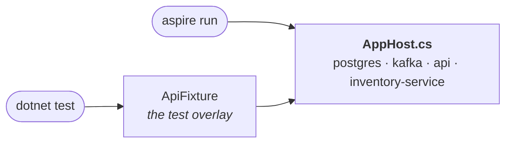
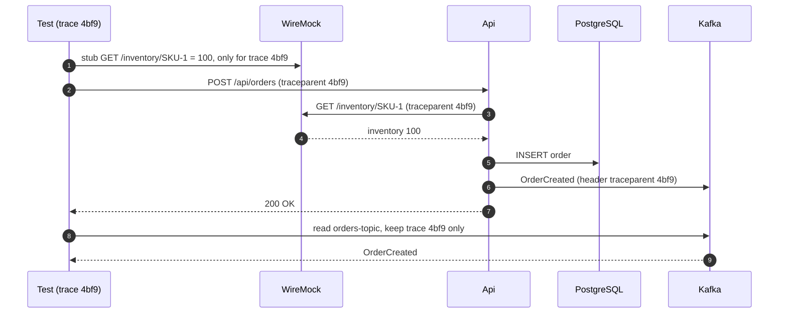

# Functional Tests

**The whole system, started for real. Every test, one trace.**

A small .NET order API with PostgreSQL, Kafka and a third-party HTTP service, plus functional tests that start the *same* system you run locally. They fake only the third party and follow each test from the first request to the Kafka message as one distributed trace.

Companion repository for the blog post **[Complete Guide to Functional Tests](https://bulatgrzegorz.github.io/complete-guide-to-functional-tests/)**.


---

## Try it

You need the [.NET 11 SDK](https://dotnet.microsoft.com/download) and Docker or Podman. The [Aspire CLI](https://get.aspire.dev) is optional: without it, the first build downloads the parts Aspire needs.

```console
dotnet test Tests/Tests.csproj
```

Then open **http://localhost:18888** and click a test. That is the whole tour.

> [!TIP]
> The first run pulls images and builds the API, so give it a few minutes. Later runs reuse what is already there.

Want the app itself, without tests?

```console
dotnet run --project AppHost   # or: aspire run --apphost AppHost/AppHost.csproj
# then send Api/CreateOrder.http → POST http://localhost:5160/api/orders
```

Or run the API as a container next to PostgreSQL and Kafka, like docker-compose:

```console
dotnet run --project AppHost -- --ApiContainer true   # or: aspire run --apphost AppHost/AppHost.csproj -- --ApiContainer true
```

On every run the AppHost first builds the image (`dotnet publish -t:PublishContainer`, no Dockerfile needed) and then starts it on the same `localhost:5160`. If you have a Dockerfile, replace the body of `ApiContainer()` in `AppHost.cs` with `builder.AddDockerfile("api", "../Api")`.

The inventory service is a third party, so the API only knows its URL (`Parameters:inventory-service-url`). In a real API that is a test or stage environment. Here it points at `InventoryService/`, a small example service the AppHost also starts, so `aspire run` works on a laptop. It reports 100 for `SKU-001`, 0 for `SKU-002` and 5 for anything else.

---

## Three tools, one job each

| | Job | In this repo |
| --- | --- | --- |
| **[Aspire](https://aspire.dev)** | Describes the system and runs it | `AppHost/AppHost.cs`: PostgreSQL, Kafka, the API, the third party |
| **[TUnit](https://tunit.dev)** | Runs the tests and gives each one its own trace | `ApiFixture` starts the AppHost once per session; every test is a span |
| **[Testcontainers](https://dotnet.testcontainers.org)** | Runs what only the tests need | a [WireMock](https://github.com/WireMock-Net/WireMock.Net) fake and the trace dashboard |

[OpenTelemetry](https://opentelemetry.io) connects them. You will see it everywhere below.

---

## Idea 1: describe the system once

`AppHost.cs` is the only place the system is described. `aspire run` starts it. `dotnet test` starts it too.



```csharp
// AppHost/AppHost.cs (trimmed)
var ordersDb = builder.AddPostgres("postgres").WithInitFiles("./Database").AddDatabase("ordersdb");
var kafka    = builder.AddKafka("kafka");   // + creates orders-topic once ready

// The third party is just a URL, set per environment (Parameters:inventory-service-url).
var inventoryService = builder.AddExternalService("inventory-service", builder.AddParameter("inventory-service-url"));

// The API: a project, or its image with --ApiContainer true. Wire gives it the same connections either way.
Wire(builder.AddDotnetProject("api", "../Api/Api.csproj").WithEnvironment("Kafka__ConnectionString", kafka));

void Wire<T>(IResourceBuilder<T> api) => api
    .WithReference(ordersDb, "Database").WaitFor(ordersDb)
    .WaitFor(kafka)
    .WithEnvironment("InventoryService__BaseUrl", inventoryService);

// Example only: a third party for `aspire run` to call (appsettings.json points inventory-service-url at it).
builder.AddDotnetProject("inventory-service-example", "../InventoryService/InventoryService.csproj");
```

The tests don't rebuild any of this. `ApiFixture` only says **what is different in a test**:

```csharp
// Tests/ApiFixture.cs (trimmed)
public class ApiFixture : AspireFixture<AppHost> {
  protected override void ConfigureBuilder(IDistributedApplicationTestingBuilder builder) {
    // every third party's URL points at WireMock
    foreach (var external in builder.Resources.OfType<ExternalServiceResource>())
      builder.Configuration[$"Parameters:{external.UrlParameter!.Name}"] = Wiremock.Url;
  }

  // the inventory mocks tests set up
  [ClassDataSource<InventoryServiceStub>(Shared = SharedType.PerTestSession)]
  public required InventoryServiceStub InventoryStub { get; init; }
}
```

So the schema, the topic, the connection strings and the startup order are the same ones you run every day. You change infrastructure in one place, and the tests follow.

| | `aspire run` | `dotnet test` |
| --- | --- | --- |
| PostgreSQL, Kafka, schema, topic | AppHost | AppHost (same) |
| API | AppHost: a project, or its image (`--ApiContainer true`) | AppHost, or in-process, or a container ([see below](#where-the-api-runs)) |
| Inventory service | its URL: here the example `InventoryService`, in a real API a test or stage environment | **WireMock**, stubbed per test |
| Dashboard | Aspire's own | a reused test dashboard at `:18888` |

> [!IMPORTANT]
> In the tests every external service points at WireMock, whatever the configuration says, so a real URL in your user secrets is never called. An external service with a fixed URL (no parameter) can't be faked, so it stops the session before the first test.

---

## Idea 2: a test is a trace

TUnit starts a new trace for every test. The API is instrumented with OpenTelemetry, so it carries that trace on every call it makes: the HTTP call to the inventory service and the message it puts on Kafka.

That trace id works as the test's **name tag**:



The API has no test code in it. It passes the trace along because that is what instrumented services do. The tests use that to stay apart:

**WireMock stubs answer only their own test.** Every stub matches on the current trace id:

```csharp
// Tests/Fixtures/WireMockFixture.cs (trimmed)
new HeaderModel {
  Name = "traceparent",
  Matchers = [new MatcherModel { Name = "WildcardMatcher", Pattern = $"*{Activity.Current.TraceId}*" }]
}
```

**Kafka reads see only their own messages.** The consumer skips messages from other traces:

```csharp
// Tests/Clients/KafkaClient.cs (trimmed)
DistributedContextPropagator.Current.ExtractTraceIdAndState(message.Headers, ..., out var receivedTraceId, out _);
if (!receivedTraceId.Contains(Activity.Current.TraceId.ToString())) continue;  // another test's order
```

So tests run in parallel against **one** WireMock and **one** topic, with no cleanup and no locks. And they still read like plain tests:

```csharp
[Test]
public async Task Should_PublishKafkaMessage_When_OrderIsCreated()
{
  var client = App.ApiClient();
  using var kafka = App.KafkaClient("orders-topic");

  var sku = "SKU-KAFKA-001";
  await App.InventoryStub.SetupInventory(sku, new InventoryResponse(100));

  var response = await client.PostOrder(sku, 25);
  await Assert.That(response.StatusCode).IsEqualTo(HttpStatusCode.OK);

  var hasMessage = kafka.ConsumeForCurrentTrace(TimeSpan.FromSeconds(10), out var receivedMessage);

  await Assert.That(hasMessage).IsTrue();
  Assert.NotNull(receivedMessage);
  await Assert.That(receivedMessage.Sku).IsEqualTo(sku);
  await Assert.That(receivedMessage.Quantity).IsEqualTo(25);
}
```

---

## Idea 3: see it

Each trace is sent to a dashboard container that stays up between runs. Open **http://localhost:18888** and the trace list reads like your test list. Each one shows the whole story:

```
Should_PublishKafkaMessage_When_OrderIsCreated   ██████████████████████████████████  functional-tests
  POST /api/orders                                 ████████████████████████████████  functional-tests
    POST /api/orders                                ██████████████████████████████   api
      GET /inventory/SKU-KAFKA-001  → WireMock       ██████                          api
      INSERT INTO orders            → PostgreSQL           ███                       api
      publish OrderCreated          → Kafka                   █████                  api
```

<sub>Roughly what you'll see. Span names come from the OpenTelemetry instrumentation.</sub>

When a test fails, you don't guess. Open its trace and you see which step went wrong: the stub that never matched, the insert that threw, the message that never left.

- Traces from earlier runs stay, because the dashboard container is reused.
- TUnit's HTML report (`TestResults/*-report.html`) includes the API's spans too.
- OTLP endpoints: `18889` (gRPC), `18890` (HTTP).

---

## Where the API runs

One switch, same tests: `ApiHost` in `Tests/appsettings.json` (easy to flip in the IDE), or the `TESTS_API_HOST` environment variable, which wins over the file (CI, command line).

| `ApiHost` | The API runs as | Use it when |
| --- | --- | --- |
| `Aspire` (default) | a project launched by the AppHost, like `aspire run` | every day |
| `InProcess` | part of the test process (`WebApplicationFactory`) | you want breakpoints in the API |
| `Container` | its published image, on Aspire's network | CI: test the image you ship |

```console
TESTS_API_HOST=InProcess dotnet test Tests/Tests.csproj
TESTS_API_HOST=Container dotnet test Tests/Tests.csproj
```

All three get their configuration from the same AppHost model. `Container` turns on the AppHost's own container mode (`--ApiContainer true`, the same one `aspire run` uses), and `Fixtures/ApiHosts.cs` reuses the AppHost's wiring for the in-process host.

---

## Adding a third-party service

Three small steps:

1. **AppHost:** declare it as a URL, set per environment, and hand it to the API in `Wire` (so the project and the container both get it).
   `.WithEnvironment("Payments__BaseUrl", builder.AddExternalService("payments", builder.AddParameter("payments-url")))`
2. **Stub:** what every test gets, and the setups tests call. TUnit creates it and injects WireMock.
   ```csharp
   public class PaymentsStub : ExternalServiceStub
   {
     protected override Task Initialize() => Task.CompletedTask; // mocks every test gets, if any
     public Task Approve(...) => DefineMock(...);                 // setups tests call
   }
   ```
3. **ApiFixture:** inject it, so tests read `App.Payments.Approve(...)`.
   ```csharp
   [ClassDataSource<PaymentsStub>(Shared = SharedType.PerTestSession)]
   public required PaymentsStub Payments { get; init; }
   ```

The tests never name its URL parameter: `ApiFixture` points every external service the AppHost declares at WireMock.

---

## Repo map

```
AppHost/
  AppHost.cs                  the system, used by aspire run and by the tests
  Database/orders.sql         schema, applied when postgres starts
Api/
  Program.cs                  POST /api/orders, /health
InventoryService/
  Program.cs                  example third party for aspire run (a real API calls an outside URL)
Tests/
  OrderTests.cs               the tests
  ApiFixture.cs               the overlay: fakes, telemetry, where the API runs
  GlobalSetup.cs              sends test spans to the dashboard and names them after the tests
  Clients/                    ApiClient (HTTP), KafkaClient (reads this test's messages)
  Stubs/                      ExternalServiceStub base; InventoryServiceStub: inventory stubs
  Fixtures/                   WireMock, dashboard, API hosts, WebApplicationFactory
```

---

<sub>Built with Aspire 17 · TUnit + TUnit.Aspire · Testcontainers · WireMock.Net · OpenTelemetry · Npgsql · Confluent.Kafka</sub>
