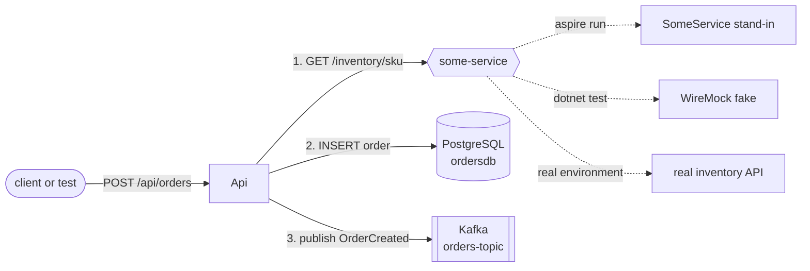

# Functional Tests Example

A small .NET order API, described once in an **Aspire AppHost**, and functional tests (**TUnit**) that start that same AppHost, swapping only what a test needs: a **WireMock** fake for the third-party service, a test **dashboard** for traces, and where the API runs. Companion repository for the blog post [Complete Guide to Functional Tests](https://bulatgrzegorz.github.io/complete-guide-to-functional-tests/).

## Quick start

You need the [.NET 11 SDK](https://dotnet.microsoft.com/download), the [Aspire CLI 17](https://get.aspire.dev) (`brew upgrade aspire`) and Docker or Podman.

```console
# the app, for real: postgres, kafka, the API and a stand-in inventory service
aspire run --apphost AppHost/AppHost.csproj
# then send Api/CreateOrder.http (POST http://localhost:5160/api/orders)

# the functional tests, against the same AppHost
dotnet test Tests/Tests.csproj
# traces: http://localhost:18888
```

## How it fits together

`AppHost/AppHost.cs` is the only description of the system. Both entry points start it:

| | `aspire run` (the service for real) | `dotnet test` (the service under test) |
| --- | --- | --- |
| Starts the AppHost | Aspire CLI | TUnit, through `ApiFixture` (`AspireFixture<AppHost>`) |
| PostgreSQL + `orders` table | AppHost (`Database/orders.sql`) | AppHost (same) |
| Kafka + `orders-topic` | AppHost (created once Kafka is ready) | AppHost (same) |
| API | AppHost, as a project | AppHost project, in-process, or a container (`TESTS_API_HOST`) |
| Inventory service (`some-service`) | `SomeService` stand-in, or a real URL if one is set | WireMock container, stubbed per test |
| Dashboard | Aspire's own, link printed on start | reused test dashboard at `http://localhost:18888` |

The AppHost decides about the third party from one setting, `Parameters:some-service-url`. When it is set (a real environment, or the tests, which always pass their WireMock's URL), `some-service` is an external URL. When it is not, the AppHost starts the `SomeService` stand-in so the demo works on a laptop.

### What calls what



`POST /api/orders` with `{ "sku": "...", "quantity": n }`:

1. asks `some-service` for the SKU's stock and returns **422** if there is less than ordered
2. inserts the order into PostgreSQL
3. publishes `OrderCreated` to Kafka and returns **200**

The stand-in reports 100 for `SKU-001`, 0 for `SKU-002` and 5 for anything else.

Telemetry follows the same request: each test starts its own trace, the API continues it, and the dashboard shows test → API → inventory call → database → Kafka as one trace.

## What goes where

```
├── AppHost/                     # Aspire AppHost: the system, used by `aspire run` and the tests
│   ├── AppHost.cs               # postgres, kafka, api, some-service (external URL or stand-in)
│   └── Database/orders.sql      # schema, applied when postgres initializes
├── Api/                         # the service under test
│   ├── Program.cs               # POST /api/orders, /health
│   └── CreateOrder.http         # a sample request
├── SomeService/
│   └── Program.cs               # stand-in for the third-party inventory service (aspire run only)
├── Tests/
│   ├── OrderTests.cs            # the tests
│   ├── ApiFixture.cs            # starts the AppHost; only what differs in a test: fakes, telemetry, API host
│   ├── GlobalSetup.cs           # points TUnit's OpenTelemetry at the dashboard; times test spans to the test itself
│   ├── Clients/                 # typed clients: ApiClient (HTTP), KafkaClient (reads this test's messages)
│   ├── Stubs/
│   │   └── ExampleServiceStub.cs       # inventory stubs for WireMock
│   └── Fixtures/
│       ├── ApiHosts.cs                 # runs the AppHost's api in-process or as a container, reusing its wiring
│       ├── WireMockFixture.cs          # WireMock container + stubs scoped to the current test
│       ├── AspireDashboardFixture.cs   # the reused test dashboard container
│       ├── LocalAppFixture.cs          # WebApplicationFactory for the in-process host
│       └── TestsConfiguration.cs       # TESTS_API_HOST
├── FunctionalTests.sln
└── global.json
```

## What is used

| Tool | Used for |
| --- | --- |
| [Aspire 17](https://aspire.dev) | the AppHost (`Aspire.Hosting.*`), running it in tests (`Aspire.Hosting.Testing`), the dashboard |
| [TUnit](https://tunit.dev) + TUnit.Aspire | test framework; `AspireFixture` starts the AppHost and waits for healthy resources; built-in OpenTelemetry for test spans |
| [Testcontainers](https://dotnet.testcontainers.org) | what the tests own: the WireMock container and the dashboard container |
| [WireMock.Net](https://github.com/WireMock-Net/WireMock.Net) | fake inventory service; stubs match on the test's `traceparent`, so parallel tests don't collide |
| [OpenTelemetry](https://opentelemetry.io) | traces and logs from the API and the stand-in, configured by the standard `OTEL_*` settings |
| PostgreSQL (Npgsql), Kafka (Confluent.Kafka) | the API's own dependencies, run by the AppHost |

## Running the tests

```console
dotnet test Tests/Tests.csproj                               # API launched by Aspire (default)
TESTS_API_HOST=InProcess dotnet test Tests/Tests.csproj      # API inside the test process: breakpoints work
TESTS_API_HOST=Container dotnet test Tests/Tests.csproj      # API as its published image, like k8s (for CI)
```

- **Third parties are always fake.** `ApiFixture.Fakes` passes a fake URL for every external service. If the AppHost declares one with no fake, the run stops before the first test.
- **Parallel tests stay apart.** Each test has its own trace; WireMock stubs and Kafka reads are scoped to it.
- **Traces stay.** The test dashboard container is reused, so earlier runs remain at `http://localhost:18888` (OTLP on 18889 gRPC, 18890 HTTP). TUnit's HTML report (`TestResults/*-report.html`) also includes the API's spans.

To point `aspire run` at a real inventory service instead of the stand-in:

```console
aspire secret set Parameters:some-service-url https://inventory.example.com --apphost AppHost/AppHost.csproj
```
